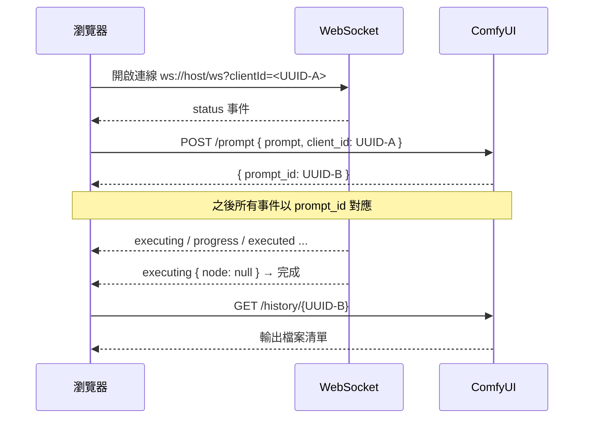

# Super Studio — 技術規格書 (Technical Specification)

> 本文描述 Super Studio 的技術實作邏輯與設計決策。需求與驗收標準請參考 `requirements.md`。

---

## 1. 系統架構概覽

### 1.1 總體架構

```
┌─────────────────────────────────────────────────────────────┐
│                    瀏覽器 (Next.js 前端)                      │
│                                                             │
│  ┌────────────┐   ┌────────────┐   ┌─────────────────────┐  │
│  │   UI 組件    │──▶│ Zustand    │──▶│  ComfyUI Client     │  │
│  │ (React)     │   │ Store      │   │  (REST 封裝)        │  │
│  └────────────┘   └────────────┘   └──────────┬──────────┘  │
│        ▲                   ▲                  │ REST         │
│        │ 訂閱             │訂閱               ▼              │
│  ┌─────┴─────┐      ┌─────┴─────┐     ┌─────────────────────┐│
│  │ Gallery   │      │ WebSocket │     │  /api/comfyui/*      ││
│  │ (結果展示) │      │  Manager  │     │  (Next.js 代理)      ││
│  └───────────┘      └───────────┘     └──────────┬──────────┘│
│        ▲                                          │           │
└────────┼──────────────────────────────────────────┼───────────┘
         │ WebSocket (ws://host/ws)                 │ HTTP
         ▼                                          ▼
┌─────────────────────────────────────────────────────────────┐
│                  本機 ComfyUI 伺服器 (127.0.0.1:8188)         │
│  - POST /prompt            提交工作流                         │
│  - GET  /history/{id}      取得輸出檔案                        │
│  - GET  /view              下載圖片/影片                       │
│  - POST /upload/image      上傳參考圖片                        │
│  - POST /upload/video      上傳源影片（放大用）                │
│  - GET  /system_stats      系統狀態                          │
└─────────────────────────────────────────────────────────────┘
```

### 1.2 雙通道通訊設計

系統使用 **兩種通訊通道**，各司其職：

| 通道 | 用途 | 協定 |
|------|------|------|
| **REST（經 Next.js 代理）** | 提交工作流、查詢歷史、上傳檔案、下載輸出 | HTTP |
| **WebSocket（瀏覽器直連）** | 即時進度、節點狀態、預覽圖片 | WebSocket |

**設計決策：為何 WebSocket 不走代理？**
- 瀏覽器原生 WebSocket 可直接連接 `ws://host/ws`，無 CORS 限制。
- 代理 WebSocket 需要額外的心跳/重連機制，徒增複雜度。
- ComfyUI 透過 `client_id` 將事件綁定到特定連線，瀏覽器直連可精準對應。

### 1.3 每次生成的識別機制



關鍵設計：
- **client_id (UUID-A)**：標識「哪個瀏覽器連線」。
- **prompt_id (UUID-B)**：標識「哪次生成任務」。
- 前端需保存 **本次任務的 prompt_id**，作為事件路由與歷史查詢的鑰匙。

---

## 2. 前端狀態管理設計

### 2.1 五個 Store 的職責劃分

| Store | 職責 | 生命週期 |
|-------|------|----------|
| `settings-store` | ComfyUI 地址、LLM 設定、主題、當前模式 | localStorage 持久化 |
| `generation-store` | 目前正在進行的生成狀態、參數、進度 | 記憶體（session） |
| `queue-store` | 生成佇列（多任務排隊、狀態、排序、中斷） | 記憶體（session） |
| `history-store` | 歷史記錄、可重複載入的參數 | localStorage 持久化 |
| `gallery-store` | 畫廊資料與操作 | localStorage 持久化 |

### 2.2 狀態流向

```
settings-store ──▶ 提供 comfyuiHost / llmXxx 給 client
                          │
generation-store ◀── 訂閱 WebSocket 事件更新進度
                          │
queue-store      ◀── 多次生成入列、依序消費、可中斷
                          │
history-store   ◀── 生成完成後寫入快照
                          │
gallery-store   ◀── 完成媒體同步至畫廊
```

**重要設計：可重複載入機制**
- 每筆歷史記錄保存一份「生成參數快照」（prompt、seed、steps、模式等）。
- 用戶點「重新載入」→ 將快照寫回 `generation-store` → 切換模式 → UI 反饋。

### 2.3 主題切換

- 使用 `next-themes` 搭配 Tailwind `darkMode: "class"`。
- 主題偏好保存在 `settings-store`，並同步至 `<html>` 的 `class` 屬性。

---

## 3. ComfyUI Client 設計

### 3.1 通用代理原則

前端**永不直接呼叫 ComfyUI REST**，一律經由 Next.js 的 `/api/comfyui/*` 代理。原因：
1. 解決瀏覽器 CORS 限制（ComfyUI 預設未開啟 CORS）。
2. 集中處理 base URL 組態（避免前端硬編碼）。
3. 便於日後加入認證、紀錄、錯誤正規化。

**代理的 address 取得方式：**
- 請求方（瀏覽器）在 Request Body 或 Header 帶上 `X-ComfyUI-Host`（來自 settings-store）。
- 代理接收後組裝完整 URL 轉發至 ComfyUI。
- 如此設定頁即可即時生效，無需重啟 Node 伺服器。

### 3.2 客戶端方法對照

| 方法 | 內部 REST 呼叫 | 用途 |
|------|----------------|------|
| `testConnection()` | `GET /system_stats` | 驗證連接、取系統資訊 |
| `queuePrompt(workflow, clientId)` | `POST /prompt` | 提交生成 |
| `interrupt()` | `POST /interrupt` | 中斷當前任務 |
| `getHistory(promptId)` | `GET /history/{promptId}` | 取輸出檔案 |
| `uploadImage(file)` | `POST /upload/image` | 上傳參考圖 |
| `uploadVideo(file)` | `POST /upload/video` | 上傳源影片 |
| `listModels(folder)` | `GET /models/{folder}` | 列模型（動態） |
| `getViewUrl(filename)` | `GET /view` | 產出縮圖/下載 URL |

### 3.3 錯誤正規化

所有客戶端方法回傳統一的結果物件：

```
成功：{ ok: true, data }
失敗：{ ok: false, error: { code, message, nodeErrors? } }
```

`nodeErrors` 來自 ComfyUI 400 回應，用於工作流驗證錯誤的詳細展示。

---

## 4. WebSocket 管理器設計

### 4.1 連線生命週期

```
init() → 開啟連線 → 收到 status → ready
        ↑                    │
   重連(指數退避)       新任務開始
        │                    ▼
        │             queuePrompt
        │                    │
        │                收到事件
        └──── 斷線 ── 依事件更新 generation-store
```

狀態機：`disconnected → connecting → connected → (reconnecting)`

### 4.2 事件分類與處理邏輯

| 事件 | 處理動作 |
|------|----------|
| `status` | 更新佇列剩餘數 |
| `execution_start` | 記錄 prompt_id，標記「產生中」 |
| `executing` | 更新「目前節點」；若 `node === null` 表示完成 |
| `progress` | 更新進度值/最大值、百分比 |
| `executed` | 若節點含輸出可即時收集（選用） |
| `execution_success` | 標記成功 → 觸發歷史拉取 |
| `execution_error` | 標記失敗 → 顯示錯誤 |
| `execution_interrupted` | 標記中斷 |

### 4.3 二進位訊息（預覽圖片）

- 非字串訊息即二進位預覽。
- **Framing 規則**：前 8 bytes 為 header（4 bytes event type + 4 bytes 格式），其餘為圖片資料。
- 型別 1 = JPEG、型別 2 = PNG。
- 組裝成 Blob → `URL.createObjectURL()` → 供 UI 即時顯示。
- 需在產生新預覽時釋放舊 ObjectURL，避免記憶體洩漏。

### 4.4 重連機制

- 使用**指數退避**：1s → 2s → 4s → ... → 上限 30s。
- 重連時沿用相同 `client_id`（保持與後端綁定）。
- 重連成功後重新取得佇列狀態。

### 4.5 單一連線共享

- 整個應用共用 **單一 WebSocket 連線**，不為每個任務開新連線。
- 事件依 `prompt_id` 路由到對應的生成任務。
- 減少連線數、簡化資源管理。

---

## 5. 工作流模板與解析

### 5.1 模板來源

| 來源 | 說明 |
|------|------|
| 內建模板 | 依 ComfyUI 環境生成（Z-Image-Turbo、MiniMax H3、放大） |
| 用戶上傳 | 用戶提供 API-format JSON |

### 5.2 內建模板結構（示意）

每個模板為「**節點圖 + 參數整形函式**」的組合：

```
template = {
  name,                // 顯示名稱
  mode,                // text2img | img2img | img_edit | text2vid | img2vid
                       // | img_upscale | vid_upscale | text2music | img23d | custom
  build(params),       // 給定參數，產生完整 workflow JSON
  extraData?,          // 上傳圖片名、特殊節點設定
}
```

`build()` 回傳符合 ComfyUI **API format** 的物件（key=node id, value=node 定義）。前端永不直接操作 UI-format（含 `nodes`/`links`）。若用戶提供 UI-format，需轉換為 API-format。

### 5.3 各模式工作流邏輯

**文生圖（Z-Image-Turbo）**
```
UNETLoader(z_image_turbo) → ModelSamplingAuraFlow → KSampler
CLIPLoader(qwen_3_4b) → CLIPTextEncode(positive) → KSampler.positive
                          ├─ ConditioningZeroOut → KSampler.negative
EmptySD3LatentImage(寬高) → KSampler.latent_image
KSampler → VAEDecode → SaveImage
```
- cfg 固定 1、sampler=`res_multistep`、scheduler=`simple`。
- 參數整形：prompt、width、height、seed、steps。

**圖生圖**
```
在文生圖基礎上，改接：
LoadImage(參考圖) → VAEEncode → KSampler.latent_image
KSampler.denoise = 用戶設定的 denoise(0~1)
```
- 上傳的圖片會先 `POST /upload/image`，取得回傳的 `name` 填入 `LoadImage.image`。

**文生/圖生視頻（MiniMax H3）**
```
UNETLoader + LoraLoader(選用) → 模型開關(turbo)
CLIPLoader(qwen3vl) + VAELoader(影像/音訊)
MiniMaxH3ImageToVideo(圖片節點) → conditioning + latent
SamplerCustomAdvanced → VAEDecode → VAEDecodeAudio → CreateVideo → SaveVideo
```
- 時長秒 → 幀數公式：`max(5, round(s*24))` 對齊到 `17k+5` 格。
- Turbo 模式：改用 LoRA + 較少步驟；非 Turbo：基礎模型 + 較多步驟。
- 圖生視頻需 `first_frame`（+ 選用 `last_frame`）。
- **輸出為影片檔**，SaveVideo 產出 MP4，存於 `output/video/`。

**圖片放大（RealESRGAN）**
```
LoadImage(源圖) → ImageUpscaleWithModel(UpscaleModelLoader RealESRGAN_x4plus) → SaveImage
```
- 依目標倍數決定：4x 直接輸出；2x 需再經 `ImageScale` 縮回半尺寸。
- 前端在畫廊選定源圖 → 廣域上傳輸入資料夾 → 套此模板。

**影片放大（SeedVR2）**
```
LoadVideo(源影片) → SeedVR2 處理節點(搭配 seedvr2 VAE) → SaveVideo
```
- 源影片需 `POST /upload/video` 上傳至 ComfyUI input 資料夾。
- 放大倍數/相關設定經設定面板控制。

**圖片編輯（Qwen-Image-2.1）**
```
LoadImage(image1..imageN) → QwenImageEdit 節點串（依參考圖數量）
Qwen-Image-2.1 UNET/CLIP/VAE → KSampler → VAEDecode → SaveImage
```
- prompt 可用 `<image1>`、`<image2>` 引用參考圖；`image1` 為編輯目標。
- 同一模式在 OpenAI 相容層也可對應 `z-image` 的單圖 img2img（見 §16）。

**文生音樂（MiniMax Music 3）**
```
UNETLoader(minimax_music3_dit_fp16) + CLIPLoader(type=minimax) + VAELoader(minimax_music3_dav)
MiniMaxMusic3TextEncode(caption=prompt, lyrics, seed, max_duration, cfg_scale=1.7)
→ ConditioningZeroOut(negative) + EmptyMiniMaxMusic3LatentAudio → KSampler(steps=30, cfg=1.7, euler/simple)
→ VAEDecodeAudio → SaveAudioMP3(quality=320k)
```
- 使用者參數：曲風描述（caption）、歌詞（可留空）、時長（5–300 秒）、seed。
- steps/cfg/sampler 由模板固定（30 / 1.7 / euler+simple），面板不暴露。
- **輸出為音訊檔**，歷史輸出 key 為 `audio`，畫廊以 `<audio>` 播放。

**圖片轉 3D（TRELLIS 2）**
```
LoadImage → RemoveBackground(birefnet) → ImageCropToMask(1024², pad 1.1)
CLIPVisionLoader(dino_v3_L) → Trellis2Conditioning
結構階段：EmptyTrellis2LatentStructure → KSampler(12) → VaeDecodeStructureTrellis2
形狀階段：Trellis2ShapeStage → KSampler(20) → Trellis2UpsampleStage(1536) → KSampler(12) → VaeDecodeShapeTrellis
紋理階段：Trellis2TextureStage → KSampler(12) → VaeDecodeTextureTrellis
網格：GetMeshInfo → RemeshMesh(768, udf) → DecimateMesh → MeshSmoothNormals
       → UnwrapMesh(4096, pec) → BakeTextureFromVoxel(4K) + BakeAmbientOcclusion + BakeNormalMapFromMesh
       → ApplyTextureToMesh → MeshToFile3D → SaveGLB
```
- 使用者參數：來源圖片、seed；不需提示詞，步驟數/解析度由模板固定。
- CFG 於結構與形狀階段以 `CFGOverride` + `RescaleCFG` + `ModelSamplingSD3` 分時控制。
- **輸出為 GLB**，歷史輸出 key 為 `3d`；`GetMeshInfo` 的文字資訊（`mesh_info.text`）不納入畫廊。
- 畫廊以 `@google/model-viewer`（client-only 動態載入）預覽模型。

### 5.4 參數整形函式（同一規格）

- 統一接收「使用者參數物件」。
- 回傳「完整 workflow」。
- 參數校驗在整形前完成（如：尺寸需為 32 的倍數、時長上下限）。

---

## 6. 自定義工作流支援

### 6.1 載入流程

```
上傳 JSON → 解析成 API-format → 掃描「可設定節點」 → 動態產生 UI
```

### 6.2 可設定節點的偵測

掃描每個節點的 inputs，判斷值形態：
- **純量（number/string/boolean）** → 具備可設定性。
- **陣列 `[nodeId, index]`** → 連接，非可設定（或僅顯示連接資訊）。

### 6.3 UI 控制項映射

| 值型別/欄位 | 控制項 |
|-------------|--------|
| INT 型態（node 標示） | 數字/滑桿 |
| FLOAT | 滑桿（含 step） |
| STRING（單行） | 文字輸入框 |
| STRING（多行, `text` 型態） | 文字區域 |
| BOOLEAN (`toggle`) | 開關 |
| COMBO（節點定義的 options） | 下拉選單 |

節點型別細節可從 `GET /object_info` 取得，用於精準映射。

### 6.4 工作流儲存/導出

- 載入的工作流 + 修改後的參數 → 組合回完整 workflow。
- **導出**：下載為 JSON 檔案（API-format）。
- **保存**：可選存入 localStorage，未來快速載入。

---

## 7. 歷史記錄設計

### 7.1 資料模型（localStorage）

```
Record = {
  id,            // prompt_id 或自產 UUID
  timestamp,     // ISO 字串
  mode,          // 生成模式
  prompt,        // 提示詞
  params,        // 參數快照
  thumbnailUrl,  // 縮圖（ObjectURL 或代理 URL）
  media,         // [{ filename, subfolder, type, kind: image|video|audio|3d }]
}
```

### 7.2 縮圖策略

- 圖片：用 ComfyUI `/view?...&preview=webp;90&res=300` 產生小縮圖 URL。
- 影片：播放器首幀截圖（`<video>` 載入後取 currentTime=0），或僅顯示圖示 + 檔名。
- 音樂（`audio`）：檔名 + 音訊圖示縮圖，畫廊內以 `<audio controls>` 播放。
- 3D（`3d`）：檔名 + 3D 圖示縮圖，畫廊內以 GLB 檢視器呈現。
- 注意：**ObjectURL 不跨 session**，故縮圖應使用可重新取得的代理 URL，存 URL 而非 blob。

### 7.3 重新載入

- 將 `Record.params` 寫回 generation-store。
- 切換 mode。
- 若有源圖（圖生圖/圖生視頻），需重新上傳或引用原檔案。

### 7.4 刪除

- 從 localStorage 移除該筆記錄。
- 批次刪除：多選 → 確認 → 移除。

---

## 8. 畫廊與結果展示

### 8.1 媒體卡片

- 依據 `kind`（image/video）渲染不同卡片。
- 圖片：`` + 燈箱開啟。
- 影片：`<video>` 預覽 + 播放按鈕。
- 卡片操作列：下載、放大、詳情。

### 8.2 「放大」操作流程

```
用戶在卡片點「放大」
  → 開啟放大面板（選擇倍數 2x/4x、確認源媒體）
  → 依模式選用對應放大模板
  → 將源媒體上傳至 input 資料夾（若尚未上傳）
  → 提交 → WebSocket 追蹤進度
  → 完成 → 新卡片加入畫廊，顯示「放大前後」對比
```

### 8.3 解析度資訊顯示

- 取得畫素/幀資訊用於對比：圖片可用 `` `naturalWidth/Height`；影片需載入後解析。
- 顯示形式：`1920×1080 → 3840×2160`。

---

## 9. API 代理端點規格

| 前端路由 | 方法 | 轉發至 | 特殊處理 |
|----------|------|--------|----------|
| `/api/comfyui/[...path]` | GET/POST | `/{path}` | 通用轉發，套用 host header |
| `/api/comfyui/prompt` | POST | `/prompt` | 轉發 body |
| `/api/comfyui/upload` | POST | `/upload/image` | multipart 轉發 |
| `/api/comfyui/upload-video` | POST | `/upload/video` | multipart 轉發 |
| `/api/comfyui/history/[id]` | GET | `/history/{id}` | 取輸出 |
| `/api/comfyui/view` | GET | `/view` | 二進位串流轉發 |

- 所有代理需處理：超時、非 2xx 狀態碼、二進位 body 的透傳（Content-Type 保留）。
- host 由請求 header `X-ComfyUI-Host` 決定；若缺省回退到設定值。

另有對外（外部工具用）的 OpenAI 相容端點，規格見 §16：

| 前端路由 | 方法 | 說明 |
|----------|------|------|
| `/api/openai/v1/models` | GET | 列出可用生圖模型（OpenAI 格式） |
| `/api/openai/v1/images/generations` | POST | 文生圖（JSON body） |
| `/api/openai/v1/images/edits` | POST | 圖生圖／圖片編輯（multipart form） |

---

## 10. 錯誤處理與使用者回饋

| 情境 | 處理 |
|------|------|
| 連不上 ComfyUI | header 顯示紅色狀態；生成按鈕禁用；提示前往設定 |
| 工作流驗證失敗 | 顯示 ComfyUI `node_errors` 的節點名稱與訊息 |
| 生成執行錯誤 | 以 toast 顯示 `exception_message` |
| 上傳失敗 | 顯示檔案格式/大小錯誤提示 |
| WebSocket 斷線 | 顯示「連線中斷」狀態；自動重連；任務狀態保留為未知 |

---

## 11. 效能與安全性注意事項

- 圖片縮圖使用 ComfyUI `/view?preview=&res=` 避免載入大圖。
- 畫廊圖片 lazy loading（`loading="lazy"`）。
- 定期釋放預覽 ObjectURL。
- 大影片檔案避免一次性讀入記憶體，使用串流/`<video>` 強制 range 請求（ComfyUI `/view` 支援）。
- 本地環境預設無 auth；若 ComfyUI 設了密碼，代理需能透傳 `Authorization` header（可由設定填入）。

---

## 12. 目錄重點說明

| 路徑 | 職責 |
|------|------|
| `lib/comfyui-client.ts` | REST 封裝、錯誤正規化 |
| `lib/websocket-manager.ts` | WebSocket 連線、重連、事件分發、二進位處理 |
| `lib/workflow-templates.ts` | 內建模板的 `build(params)` |
| `lib/workflow-parser.ts` | 自定義工作流解析、可設定節點偵測、UI 映射 |
| `lib/modes.ts` | 十種生成模式的註冊與 meta |
| `lib/openai-compat.ts` | OpenAI Images API 相容層（模型解析、參數校驗、提交與輪詢、回應轉換） |
| `lib/llm-client.ts` | OpenAI 相容 API（Ollama 等）客戶端、錯誤正規化 |
| `lib/prompt-optimizer.ts` | 提示詞優化／圖片反推的 prompt 構建與解析 |
| `lib/drag-drop.ts` | 拖放上傳輔助 |
| `lib/storage.ts` | localStorage 封裝（含版本管理） |
| `stores/*` | 五個 Zustand store（settings/generation/queue/history/gallery） |
| `hooks/use-generation.ts` | 綁定 client + WebSocket + store 的生成流程 |
| `hooks/use-llm.ts` | LLM 優化/反推流程 |
| `app/api/comfyui/*` | Next.js ComfyUI 代理 |
| `app/api/llm/*` | Next.js LLM（OpenAI 相容）代理 |
| `app/api/openai/v1/*` | 對外的 OpenAI Images 相容端點（見 §16） |
| `app/api-docs/` | 站內 OpenAI 相容 API 說明頁 |
| `components/gallery/glb-viewer.tsx` | GLB 3D 預覽（`@google/model-viewer`，client-only） |
| `app/queue/` | 生成佇列頁面 |

---

## 13. 生成流程：端到端時序

```
1. 用戶填參數 → 點「生成」
2. generation-store 記錄參數、狀態=queued
3. 依 mode 呼叫 template.build(params) → workflow
4. 若需上傳參考媒體 → 先上傳 → 取得檔案名
5. 確保 WebSocket 已連接 → queuePrompt(workflow, clientId)
6. 取得 prompt_id → generation-store 記錄
7. WebSocket 事件依 prompt_id 更新進度/節點/預覽
8. 完成(success) → getHistory(prompt_id) → 輸出檔案
9. 組裝 media、產生縮圖 → 加入畫廊 + 寫入 history-store
10. 失敗 → 標記錯誤 → toast 提示
```

---

## 14. 生成佇列設計

### 14.1 任務資料模型

```
QueueTask = {
  id,             // 本地生成 `q_<ts>_<rand>`
  params,         // GenerationParams 快照（含 mode）
  status,         // pending | queued | running | completed | failed | cancelled
  promptId?,      // ComfyUI prompt_id（實際提交後）
  progressValue, progressMax,
  currentNode,
  error?,
  createdAt, completedAt?,
}
```

### 14.2 佇列流程

```
用戶連續點「生成」→ 每次加一筆 pending task
   → 消費循環：取最早的 pending → status=queued → 依 mode 建 workflow
   → 上傳參考媒體 → queuePrompt → status=running（記錄 prompt_id）
   → WebSocket 事件（executing/progress/execution_success/error/interrupted）依 prompt_id 更新對應 task
   → 完成 → 寫入 history-store + gallery-store → status=completed
   → 失敗/中斷 → status=failed/cancelled
```

### 14.3 操作

- **重新排序**：僅執行中的待處理（pending）可上移/下移，禁止跳到已開始的任務之前。
- **中斷**：刪除執行中任務前呼叫 `cancelTask(id)`（`/interrupt`）再移除；佇列中（未開始）直接移除。
- **載入參數**：將 `task.params` 寫回 `generation-store` 並切換 mode，回到工作台。
- **清除已完成**：一次移除全部 completed/failed/cancelled。

---

## 15. LLM 提示詞優化與圖片反推

### 15.1 通訊設計

- 瀏覽器隨時呼叫同源 `/api/llm/*` 代理，攜帶 `X-LLM-BaseURL`/`X-LLM-Model`/`X-LLM-ApiKey` header。
- 代理組裝完整 URL 轉發至 OpenAI 相容 API（預設 Ollama `:11434/v1`），瀏覽器不直接外連。
- 錯誤正規化與 comfyui-client 相同：`{ ok:true, data }` / `{ ok:false, error }`。

### 15.2 提示詞優化

```
用戶點「優化提示詞」
   → buildOptimizeMessages(prompt, negative, imageDescription?) → chat()
   → parseOptimizedPrompt() 抽 JSON { positive, negative }
   → 回填 generation-store params.prompt / params.negativePrompt
```

- System prompt 要求模型只回應 `{"positive": "...", "negative": "..."}` JSON；解析器容忍 code fence 與前後贅字。
- 無 LLM 連線或解析失敗 → destructive toast「請檢查 LLM 設定」。

### 15.3 圖片反推（多模態）

- 僅模式有參考圖（img2img）時，按鈕改為「反推圖片並優化」。
- 參考圖經 `getViewUrl` 取代理 URL → 由前端讀成 dataURL → `buildDescribeMessages(dataUrl)` 送多模態 model。
- 模型回傳圖片英文描述 → 再走優化流程 → 回填正負向提示詞。

---

## 16. OpenAI 相容層（對外生圖 API）

### 16.1 目的與範圍

讓外部工具以 OpenAI Images API 格式呼叫本專案的 ComfyUI 生圖能力。**僅涵蓋文生圖與圖片編輯**；影片、放大、音樂、3D 仍只在工作台內使用。

### 16.2 端點

| 端點 | 方法 | 請求 | 說明 |
|------|------|------|------|
| `/api/openai/v1/models` | GET | — | 回傳可用模型與建議參數 |
| `/api/openai/v1/images/generations` | POST | JSON | 文生圖 |
| `/api/openai/v1/images/edits` | POST | multipart | 圖生圖／圖片編輯 |

三者皆提供 `OPTIONS`（CORS 預檢，允許任意來源）。

### 16.3 ComfyUI 目標解析

```
host = X-ComfyUI-Host header → COMFYUI_HOST 環境變數 → DEFAULT_HOST
auth = X-ComfyUI-Auth header → COMFYUI_AUTH 環境變數
timeout = OPENAI_COMPAT_TIMEOUT_MS（毫秒，預設 600000）
```

走 server-to-server 呼叫（不需 WebSocket），因此 ComfyUI 必須是本伺服器可連線的位址。

### 16.4 參數

| 欄位 | 說明 |
|------|------|
| `model` | `z-image`（預設）或 `qwen-image-2.1`；未知值回 404 `model_not_found` |
| `prompt` | 必填 |
| `n` | 張數 1–4，預設 1 |
| `size` | `寬x高`，64–4096；`auto` 等同預設 1024x1024 |
| `response_format` | `url` / `b64_json`；generations 預設 `url`，edits 預設 `b64_json` |
| `seed` / `steps` / `cfg` / `negative_prompt` | 擴充欄位；steps/cfg 未給時依模型建議值 |
| `denoise` | 僅 edits；z-image 單圖 img2img 的改動幅度（預設 0.6） |

edits 以 `model` 決定工作流：`qwen-image-2.1` 走多參考圖指令編輯，其餘走 `z-image` img2img。

### 16.5 執行流程與回應

```
queueWorkflow(POST /prompt) → 取得 prompt_id
→ 每 1 秒輪詢 /history/<prompt_id> → 有 images 輸出即回傳
→ url 模式組 /api/comfyui/view 代理網址；b64_json 模式直接取回二進位轉 base64
```

- 成功：`{ created, data: [{ url | b64_json }] }`。
- 失敗：`{ error: { message, type, param, code } }`（如 `invalid_request_error`、`model_not_found`、`comfyui_unreachable`、`timeout`）。
- 實作集中於 `lib/openai-compat.ts`，工作流直接複用 `lib/workflow-templates.ts`。
- 站內說明頁位於 `app/api-docs/`；預設無驗證，公開部署時應在前方加反向代理與驗證。

---

*本文為實作邏輯規格，實際程式碼以實作階段為準。*
